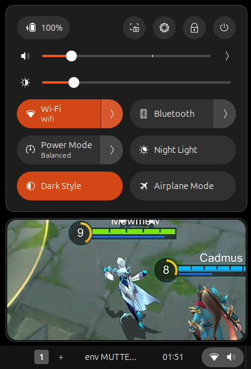
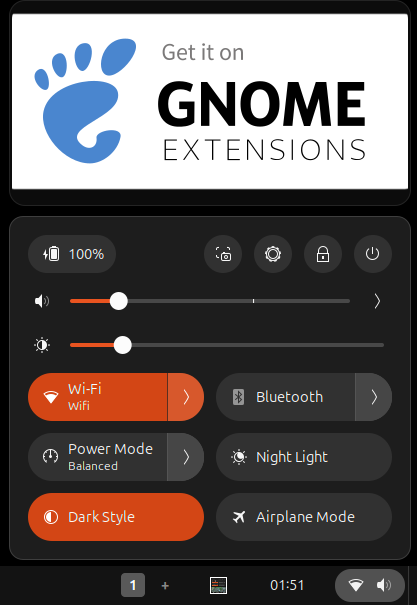
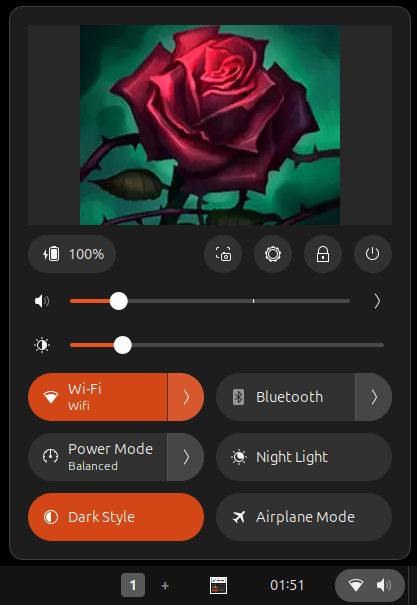
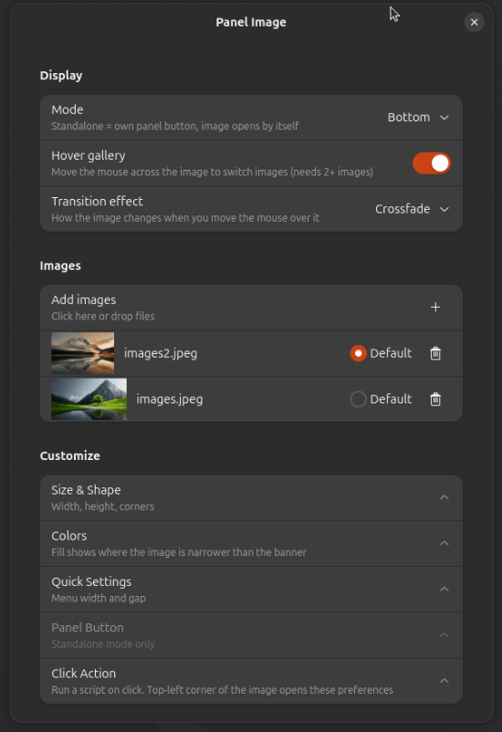

# Avatar-Gnome-Shell-Extension

Adds top image to the top panel to execute your favourite app, it even has hover play gallery. Supports Gnome 45, 46, 47, 48, 49.

Available on gnome EGO:

# Changelog

### v 1.0.1
- Added Hover Images

 

# Screenshots

    
    
    

### Notes

Inspired by [Avatar](https://github.com/pawelswiszcz/Avatar-Gnome-Shell-Extension)

Names is [Abror](https://kachka_pachka.t.me)

